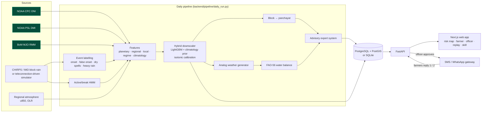
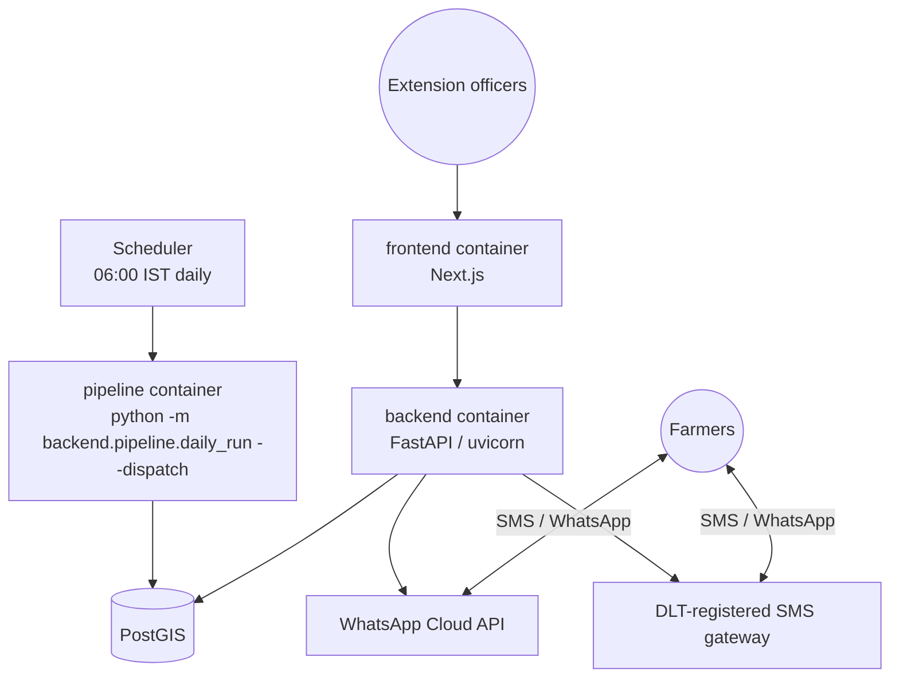

# Varsha — System Architecture

SIH 2026 · Problem statement **26086** · *Hyperlocal Monsoon Onset & Break Prediction System (Block/Village Scale)* · MoES / NCMRWF

Varsha produces a **7–30 day probabilistic outlook** of monsoon onset, false onset, dry spells (breaks) and
heavy rain for every **block and gram panchayat** in the pilot. It turns those probabilities into
**crop-specific advisories** and delivers them in **Telugu, Hindi and English** by SMS / WhatsApp,
after an agricultural extension officer approves them.

This document maps each requirement in the problem statement to the code that implements it.

---

## 1. Requirements → components

| Problem statement asks for | Where it lives |
|---|---|
| Ingest ENSO, IOD, MJO | `data/fetchers/enso_oni.py`, `iod_dmi.py`, `mjo_bsiso.py` → `data/sources.py::load_drivers` (real NOAA CPC / NOAA PSL / BoM data, with publication lags applied) |
| Regional atmospheric data | 850 hPa low-level jet and OLR anomaly predictors (`models/features.py`); ERA5 fetcher stub in `data/fetchers/era5.py` |
| Hybrid model pairing planetary drivers with local data | `models/downscaling/hybrid.py`: LightGBM on top of a climatology prior, plus a 2-state HMM regime model (`models/hmm/regime.py`) and the projected MJO phase as a physics-based lead feature |
| Downscale to block / panchayat | block-level training targets; block → panchayat IDW plus panchayat soil water balance (`models/downscaling/panchayat.py`, `impact/water_balance.py`) |
| Onset thresholds, active/break durations | `models/events.py` (onset, false onset, dry spells, heavy rain), `models/onset/status.py`, HMM expected spell durations |
| 1–4 week probabilities | horizons 7/14/21/30 days, one model with horizon as a feature; calibrated and physically consistent (`enforce_consistency`) |
| Colour-coded risk maps (block / panchayat) | `frontend/app/page.js` + `components/RiskMap.js`; API `GET /api/v1/forecasts/map` |
| Expert system → crop advisories | `impact/advisory_engine.py` + `config/advisory_rules.yaml` (ICAR-CRIDA contingency-style rules, cost-loss sowing decision, seedling survival) |
| Regional languages | Telugu / Hindi / English templates in `advisory_rules.yaml`; `translation/adapter.py` (Bhashini, else glossary) for officer edits |
| SMS / WhatsApp gateway, extension officers | `backend/services/messaging.py`, `backend/routers/messaging.py`, officer console `frontend/app/officer` |
| Mobile-optimised web app | `frontend/app/farmer` (Telugu-first, works at phone width) |

---

## 2. End-to-end data flow



### Daily run (issue date *t*, only data up to *t − 1*)

1. **Data:** store yesterday's block rainfall and temperature; refresh teleconnection indices (ONI lag 45 days, DMI lag 30 days, RMM lag 1 day, matching real publication delays).
2. **Events and state:** observed onset status per block (not yet / provisional / established / false onset), HMM-filtered P(break), soil moisture from the water balance.
3. **Forecast:** 25 blocks × 4 horizons → probabilities of 6 events and 5 rainfall quantiles, with TreeSHAP driver attributions and a plain-language explanation.
4. **Downscale:** IDW to 125 panchayats, then panchayat soil moisture from each panchayat's own soil (red sandy loam / red loam / black cotton).
5. **Advise:** for every panchayat × crop, compute the seedling survival probability if sown today (forecast-conditioned analog ensemble run through the water balance), then evaluate the rule base.
6. **Store:** forecasts, panchayat forecasts and advisories (status `pending`).
7. **Deliver:** an officer reviews, edits or approves; `POST /officer/dispatch` sends SMS / WhatsApp in each subscriber's language. Replies (1 = rained, 2 = no rain, STOP) become `FarmerFeedback` ground truth.

---

## 3. The hybrid forecast model

**Targets** (per block, issue date and horizon *h* ∈ {7, 14, 21, 30}). These are defined once in `models/events.py`, so training, verification and the dashboard all mean the same thing:

| Event | Definition |
|---|---|
| Onset | ≥ 20 mm in 3 consecutive days, with the spell starting inside the window (after 15 May) |
| False onset | an onset spell in the window followed by a ≥ 7-day dry spell within 30 days |
| Dry spell 7 / 14 | ≥ 7 / ≥ 14 consecutive days < 2.5 mm beginning in the window (counted from the issue day) |
| Heavy / very heavy | any day ≥ 64.5 / ≥ 115.6 mm in the window (IMD thresholds) |
| Rainfall | window total; quantiles q10, q25, q50, q75, q90 |

**Features** (all known on the morning of *t*):

- *Planetary:* ONI, DMI, RMM1/2, MJO amplitude, phase effect on Indian convection, and the **MJO phase projected to the middle of the forecast window**. The MJO propagates about 8° a day, which gives a physical source of 2–4 week skill.
- *Regional:* 850 hPa low-level jet and OLR anomalies (1–3 day lead on regime changes), and regional rainfall.
- *Local:* 3/7/14/30-day rain, current dry run, season total, soil moisture, onset state.
- *Regime:* HMM-filtered probability of being in a break.
- *Static and climatology:* latitude, longitude, elevation, day of year, horizon, and the block's own climatological probability of each event.

**Learning:**

- One LightGBM classifier per event. Its boosting `init_score` is the block climatology log-odds, so trees only learn departures from climatology.
- Quantile regressors handle rainfall amounts.
- Isotonic calibration is fitted on out-of-fold hindcasts.
- Consistency constraints are applied: nested windows are monotone in horizon, P(14-day dry) ≤ P(7-day dry), P(very heavy) ≤ P(heavy), and P(false onset) ≤ P(onset).

**Explainability:** exact TreeSHAP contributions (`pred_contrib=True`), summed into driver groups ("MJO (projected)", "ENSO", "Recent local rain", …), are stored with every forecast and shown on the dashboard.

**Verification** (`models/verification/skill.py`, `models/train.py`):

- Leave-years-out cross-validation over 1991–2022; the climatology reference is refitted without the test years.
- Metrics: Brier Skill Score vs. block climatology, ROC AUC, reliability diagrams, and pinball loss / 10–90% coverage for rainfall.
- 2023 is held out completely and replayed day by day.
- Per-block skill becomes a **trust score**. The confidence label shown with each forecast comes from hindcast BSS.

---

## 4. Advisory expert system

Rules are evaluated in priority order (`config/advisory_rules.yaml`). Every advisory stores the rule that fired and all its inputs (`reasoning`), so an officer can audit it.

| Rule | Action | Condition (simplified) |
|---|---|---|
| very_heavy_alert | ALERT | P(≥115.6 mm, 7 days) ≥ 0.30 |
| switch_crop | SWITCH | not sown and the sowing window is closed, or onset is still absent after 15 July |
| pre_season | WAIT | before the crop's sowing window |
| sow_go | SOW | onset provisional/established (or P(onset, 7 days) ≥ 0.7), soil moisture adequate, **P(seedling survival \| sow today) > 1 − cost/loss ratio** |
| sow_wait | WAIT | onset signal present but survival / soil / false-onset checks fail |
| resow_alert | RESOW_ALERT | seedlings in the initial stage and P(14-day dry spell) ≥ 0.5 |
| protect | PROTECT | sensitive stage and P(7-day dry spell, week 1) ≥ 0.6 |
| irrigate | IRRIGATE | soil moisture ≤ 0.35 and P(dry spell) ≥ 0.5 in development / mid season |
| heavy_prepare | PREPARE | P(≥64.5 mm, 7 days) ≥ 0.5 |
| break_conserve | CONSERVE | active regime now, P(dry spell, 14 days) ≥ 0.6 **and** ≥ 12 points above climatology |

**Seedling survival:** about 650 historical 30-day rainfall sequences for the block, starting within ±10 days of the issue date, are importance-weighted. The weights make the ensemble reproduce the forecast (event likelihood ratios plus a quantile-bin correction on the 30-day total). Each sequence then runs through the FAO-56 bucket for the panchayat's soil with seedling rooting depth. A seedling dies if water stress lasts longer than the crop's critical dry-spell length.

---

## 5. Software components

```
data/        fetchers (NOAA, BoM, CHIRPS, ERA5, ...), climate_simulator.py, sources.py
models/      events, features, baselines/climatology, hmm/regime, downscaling/{hybrid,panchayat},
             onset/status, weather_generator, verification/skill, train, forecast_engine
impact/      water_balance (FAO-56), advisory_engine (expert system)
translation/ Bhashini / glossary adapter + Telugu and Hindi glossaries
backend/     FastAPI app, DB models (portable PostGIS/SQLite geometry), pipeline, services
             (bundles = read models, export = static JSON, messaging = SMS/WhatsApp)
frontend/    Next.js 16: risk map, farmer view, officer console, 2023 replay, skill page
scripts/     bootstrap_demo, load_boundaries, create_tables, extract_chirps_blocks
config/      pilot region, event thresholds, crop parameters, advisory rules + texts
```

**API** (FastAPI, docs at `/docs`):

| Area | Endpoints |
|---|---|
| Dashboard | `GET /api/v1/dashboard/latest`, `/dashboard/drivers` |
| Forecasts | `GET /api/v1/forecasts/latest`, `/block/{id}`, `/panchayat/{id}`, `/map?event=&horizon_days=&level=`, `/timeseries/{id}` |
| Advisories | `GET /api/v1/advisories/panchayat/{id}?language=te`, `/block/{id}` |
| Officer (HTTP Basic) | `GET /officer/pending`, `POST /officer/review/{id}`, `/officer/approve-all`, `/officer/dispatch`, `GET /officer/stats` |
| Messaging | `POST /messaging/subscribers`, `GET /messaging/outbox`, `POST /messaging/inbound`, `GET/POST /messaging/whatsapp/webhook` |
| Feedback | `POST /feedback/report`, `GET /feedback/summary/{id}` |
| Replay | `GET /replay/bundle`, `/replay/timeline`, `/replay/snapshot/{date}` |
| Verification | `GET /verification/skill`, `/summary`, `/blocks` |
| Pipeline (officer) | `POST /pipeline/run?run_date=`, `GET /pipeline/runs` |

**Storage:**

- The production target is PostgreSQL + PostGIS (`docker compose up`). Geometries become real `geometry(MULTIPOLYGON, 4326)` columns.
- Local, test and offline-demo runs use SQLite with GeoJSON text through the same column type (`backend/db/types.py`).
- The web app reads the API. If the API is unreachable, it falls back to static JSON written by `backend/services/export.py`, so judges can open it on any static host.

---

## 6. Deployment



- Scheduling: a cron or Kubernetes CronJob runs the pipeline every morning; `docker compose --profile pipeline run pipeline` runs it on demand.
- Scaling to a whole state: training cost grows linearly with the number of blocks (33 seasons × 25 blocks ≈ 166 k rows trains in about 90 s on a laptop), and inference is under 1 s per issue date for the pilot.

---

## 7. What is real and what is synthetic (prototype)

| Item | Status |
|---|---|
| ENSO (ONI), IOD (DMI) | **Real** NOAA data, fetched live and cached |
| MJO RMM | **Real** BoM data, except the 2023 Kharif season, which uses a scripted path consistent with the demo scenario |
| Block rainfall | **Synthetic**: teleconnection-driven stochastic simulator, calibrated to Telangana (≈ 560–800 mm JJAS, ≈ 43 rainy days, frequent false onsets). Replaced automatically by CHIRPS block means once `scripts/extract_chirps_blocks.py` has been run. |
| 2023 season | Scripted scenario modelled on the observed season (early-June false onset in the west, late-June onset, wet late July, August break) |
| u850 / OLR | Simulated stand-ins for ERA5 / NOAA OLR |
| Block, panchayat boundaries and soils | **Synthetic** approximations; replace the GeoJSON in `data/sample/boundaries/` with LGD boundaries |
| Telugu / Hindi texts | Drafted for the prototype; need agronomist review before field use |
| SMS / WhatsApp | Mock outbox by default. Real adapters exist (`MESSAGING_MODE=whatsapp/sms`); demo subscribers use invalid numbers and are never messaged. |

Every forecast, advisory and API payload carries `is_synthetic`.
